# CIA Triad and Cybersecurity Practices

*Learning About the CIA Triad and Practising Basic Cybersecurity Skills*

## 1. Introduction

In this part of my cybersecurity learning journey, I explored the CIA Triad and learned about some of the fundamental principles used to protect information and computer systems.

I didn't just want to understand the definitions; I also wanted to see how some of these concepts work in practice.

I explored different security tools, used Windows Command Prompt, tested password strength, encrypted a file using Windows EFS, and generated a SHA-256 hash.

Here, I've documented what I learned, the practical exercises I carried out, what I observed, and screenshots of my activities.

## 2. What Is Cybersecurity?

One of the things I learned is that cybersecurity is about protecting computers, networks, applications, systems, and data from unauthorized access, attacks, damage, or disruption.

In simple terms, it involves putting measures in place to keep information and digital systems safe.

I also learned that cybersecurity isn't just about preventing attacks. It involves protecting information, identifying threats, responding to incidents, and making sure systems remain available when needed.

## 3. Understanding the CIA Triad

I learned that the CIA Triad is one of the fundamental concepts in cybersecurity. It consists of three important principles:

- Confidentiality
- Integrity
- Availability

These three principles help explain what information security is trying to protect.

### A. Confidentiality

Confidentiality means ensuring that information is only accessible to people who are authorized to see it.

For example, my personal files, bank details, and account passwords should not be accessible to just anyone.

I learned about some security measures that help maintain confidentiality:

- **Passwords:** Help prevent unauthorized access to accounts and systems.
- **Multi-Factor Authentication (MFA):** Adds another verification step when accessing an account.
- **Encryption:** Converts readable information into an unreadable form that requires the appropriate key to access.
- **Access Control:** Determines who is allowed to access particular information or resources.
- **Firewalls:** Help control incoming and outgoing network traffic.
- **Data Loss Prevention (DLP):** Helps prevent sensitive information from being improperly shared or transferred.

### B. Integrity

Integrity means ensuring that information remains accurate, complete, and protected from unauthorized changes.

For example, if someone changes the amount in a financial record without permission, the integrity of that information has been compromised.

Some of the controls I learned about include:

- **Hashing:** Helps verify whether a file or piece of data has changed.
- **Digital Signatures:** Help verify the authenticity and integrity of digital information.
- **File Integrity Monitoring (FIM):** Helps detect unauthorized changes to files.
- **Access Control:** Restricts who can modify information.
- **Audit Logs:** Keep records of activities that can help identify changes and investigate incidents.

### C. Availability

Availability means ensuring that information, applications, and systems are accessible to authorized users whenever they are needed.

For example, imagine trying to access your bank's website and discovering that the service is unavailable. That is an availability problem.

Some measures that help maintain availability include:

- **Regular Backups:** Help recover information if it is lost or damaged.
- **Redundant Servers:** Provide alternative systems when one server fails.
- **Load Balancing:** Distributes traffic across multiple servers.
- **Disaster Recovery:** Provides a plan for restoring systems after a major incident.
- **Failover Mechanisms:** Help switch operations to backup systems when the primary system fails.
- **DDoS Protection:** Helps defend systems against traffic-based attacks intended to make services unavailable.
- **Regular Maintenance:** Helps keep systems reliable and functional.

One thing I took away from learning the CIA Triad is that protecting information involves more than keeping it secret. Information must also remain accurate and accessible.

## 4. My Practical Exercises

After learning about these concepts, I moved on to some practical exercises to understand how different cybersecurity tools and features work.

### Exercise 1: Scanning a URL with VirusTotal

**Tool:** VirusTotal

For this exercise, I explored VirusTotal, a platform that analyzes files, URLs, domains, and IP addresses using multiple security vendors and detection engines.

I wanted to understand how a suspicious website could be checked for potential threats.

**What I did:**

1. Opened VirusTotal.
2. Selected the URL scanning option.
3. Submitted a controlled phishing-test URL.
4. Reviewed the results returned by the different security vendors.

**Test URL:**

`http://testsafebrowsing.appspot.com/s/phishing.html`

**What I learned:**

I saw how different security vendors analyze a URL and report whether they consider it suspicious or potentially harmful.

I also learned that a clean result does not automatically guarantee that a website is safe. It simply means the available security engines did not identify a threat at the time of the scan.

**My screenshots:**

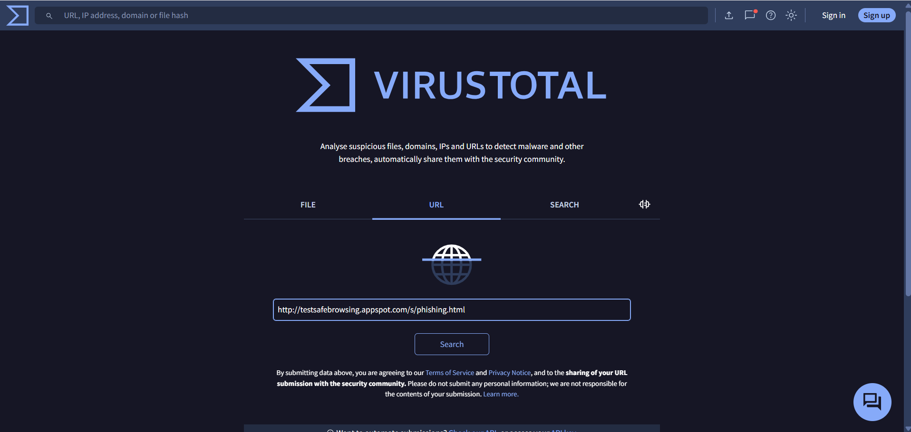

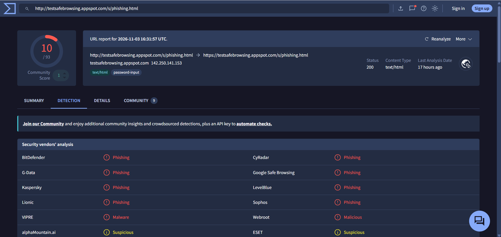

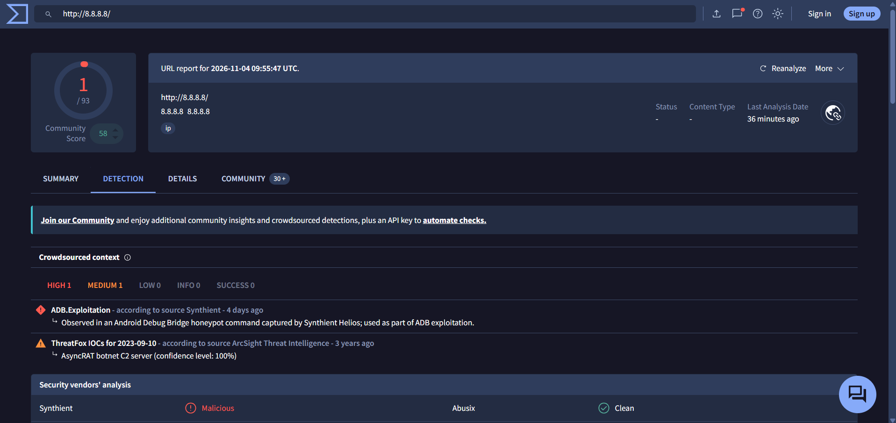

### Exercise 2: Performing a WHOIS Domain Lookup

**Tool:** Who.is

Next, I explored WHOIS lookup and how it can be used to retrieve publicly available information about a registered domain.

**What I did:**

1. Opened Who.is.
2. Searched for `example.com`.
3. Reviewed the domain information returned by the website.

**What I learned:**

A WHOIS lookup can provide information such as:

- Domain registrar.
- Domain registration date.
- Domain expiration date.
- Nameservers.
- Other available registration details.

I also learned that some domain owners use privacy protection to hide their personal registration information.

This exercise helped me understand how publicly available domain registration information can be useful during basic investigations.

**My screenshots:**

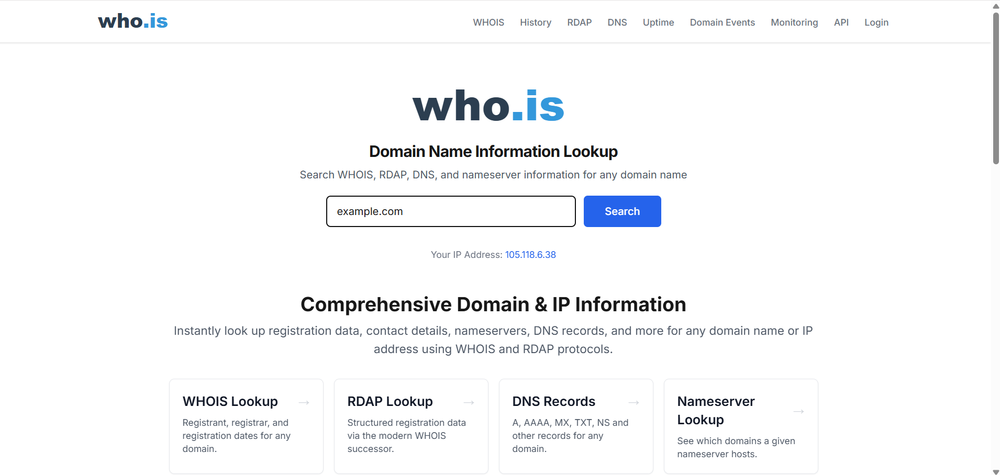

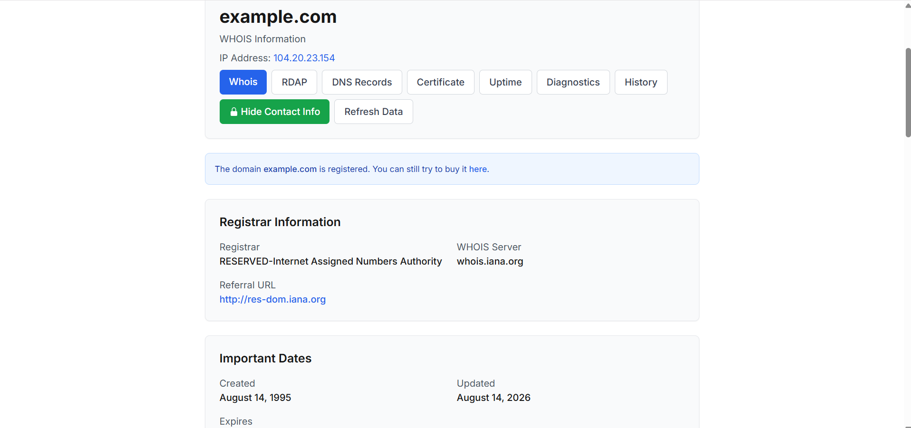

### Exercise 3: Checking an IP Address Reputation

**Tool:** VirusTotal

For this exercise, I used VirusTotal to investigate the reputation of an IP address.

I searched for:

`8.8.8.8`

**What I observed:**

The results showed that 1 out of 93 security vendors flagged the IP address, while most of the other vendors did not report a detection.

I also noticed a community score of 58 and some additional threat intelligence reports involving historical suspicious activity.

**What I learned:**

I learned that IP reputation checks can provide useful information about whether an IP address has previously been associated with suspicious activity.

However, a reputation result should not be treated as final proof that an IP address is currently malicious.

In this case, the results do not prove that Google's public DNS service is malicious. Historical reports, shared infrastructure, and third-party intelligence can influence reputation information.

This taught me to look beyond a single detection and consider the wider context before drawing conclusions.

### Exercise 4: Performing a DNS Lookup with nslookup

**Tool:** Windows Command Prompt

I also explored the `nslookup` command and learned how it helps retrieve DNS information.

DNS stands for Domain Name System. It helps translate human-readable domain names into IP addresses.

**What I did:**

I opened Windows Command Prompt and entered:

```cmd
nslookup google.com
```

**What I learned:**

The command returned DNS information, including the DNS server used and the IP address records returned for the domain.

I learned that `nslookup` can be useful when investigating domain resolution problems and checking DNS records.

**My screenshot:**

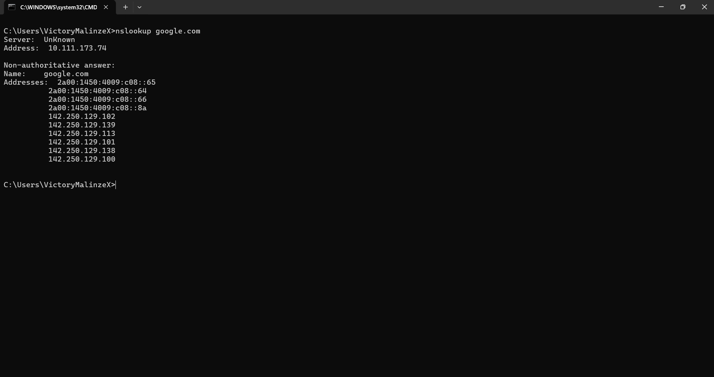

### Exercise 5: Exploring Network Information with ipconfig and netstat

**Tool:** Windows Command Prompt

During my learning, I also explored two Windows commands: `ipconfig` and `netstat`.

I wanted to understand what information they provide about a computer's network activity.

#### 1. Using ipconfig

I entered:

```cmd
ipconfig
```

I learned that this command displays network configuration information such as:

- Local IP address.
- Subnet mask.
- Default gateway.

#### 2. Using netstat

I entered:

```cmd
netstat -an
```

I learned that this command displays network connections and listening ports, along with their associated addresses.

**What I learned:**

Although both commands relate to networking, they serve different purposes.

`ipconfig` helps me understand my computer's network configuration, while `netstat` helps me inspect network connections and listening ports.

I also learned that `netstat` is not a command for discovering nearby devices on a network.

**My screenshot:**

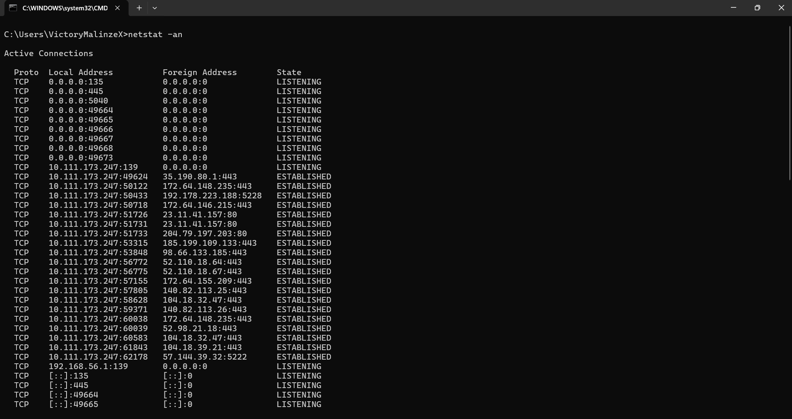

### Exercise 6: Testing Password Strength

**Tool:** Password Monster

For this exercise, I explored Password Monster to understand how password strength can be evaluated.

**What I did:**

1. Opened Password Monster.
2. Entered sample passwords for testing.
3. Reviewed the strength assessments and feedback provided by the tool.

**What I learned:**

I learned that password length and complexity are important when creating strong passwords.

Using unique passwords for different accounts also helps reduce the damage that can happen if one password is exposed.

I also learned that Multi-Factor Authentication provides an additional layer of account protection.

A security precaution I followed: I used sample passwords rather than my actual personal passwords. It is important not to submit passwords currently used for personal accounts to online password-testing websites.

**My screenshots:**

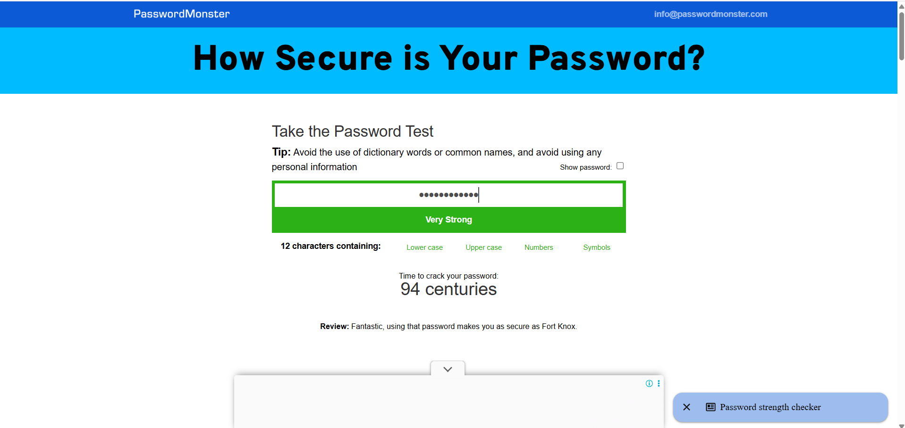

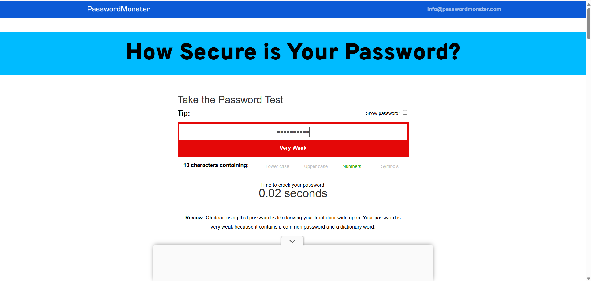

### Exercise 7: Encrypting a File Using Windows EFS

**Tool:** Windows Encrypting File System (EFS)

This was one of the practical exercises I carried out using a Windows feature.

I explored how Windows EFS can be used to encrypt files and folders.

I learned that EFS stands for Encrypting File System and is available on supported Windows editions and NTFS volumes.

**What I did:**

1. Located the file or folder I wanted to encrypt.
2. Right-clicked it and opened Properties.
3. Selected the General tab.
4. Clicked Advanced.
5. Selected Encrypt contents to secure data.
6. Applied the encryption settings.
7. Confirmed the encryption process.

**What I learned:**

I learned that EFS helps protect files by encrypting their contents.

The encryption uses a certificate and private key associated with the Windows user. This means that protecting and backing up the EFS certificate and private key is very important.

If the necessary certificate or private key is lost, recovering access to encrypted files may become difficult or impossible.

This exercise helped me understand how encryption can support the confidentiality principle of the CIA Triad.

**My screenshots:**


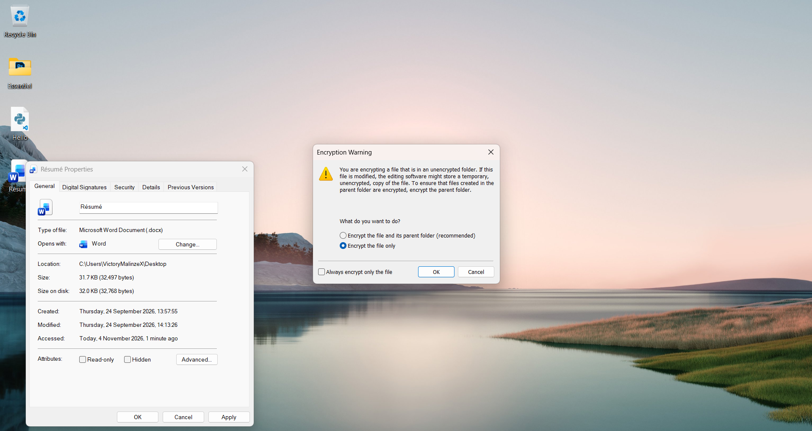

### Exercise 8: Generating a SHA-256 Hash

**Tool:** Windows Command Prompt

For this exercise, I explored file hashing and how it can be used to check file integrity.

I learned that hashing converts data into a fixed-length value using a hashing algorithm.

I used SHA-256, which is a cryptographic hash algorithm.

**What I did:**

1. Located a Word document on my Desktop.
2. Opened Windows Command Prompt.
3. Entered the `certutil` command.
4. Generated the SHA-256 hash of the document.
5. Reviewed the hash value returned by Command Prompt.

**Command I used:**

```cmd
certutil -hashfile "C:\Users\VictoryMalinzeX\Desktop\Essentiel\Résumé.docx" SHA256
```

**What I learned:**

The command generated a hash value for the selected document.

I learned that if the file is modified, its SHA-256 hash will normally change.

By comparing the hash of a file before and after a transfer or modification, it is possible to check whether the file's contents have changed.

I also learned an important distinction: hashing is not encryption. Hashing does not hide the contents of a file, and it is not designed to be reversed to recover the original document.

**My screenshots:**

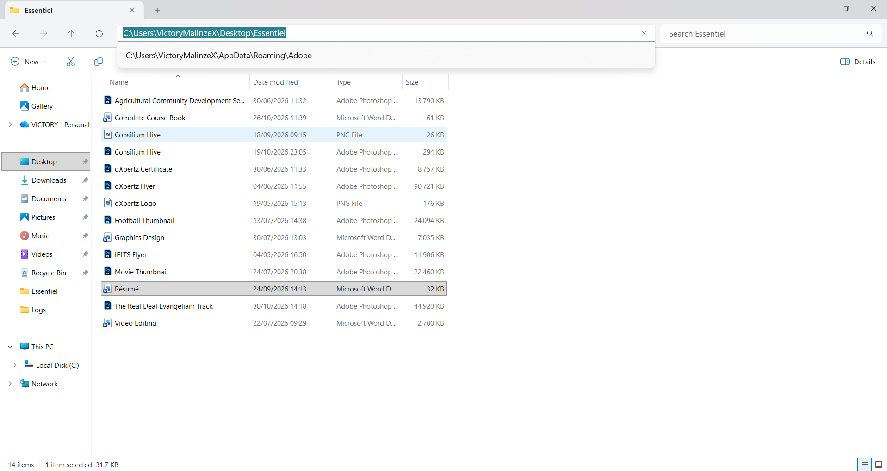

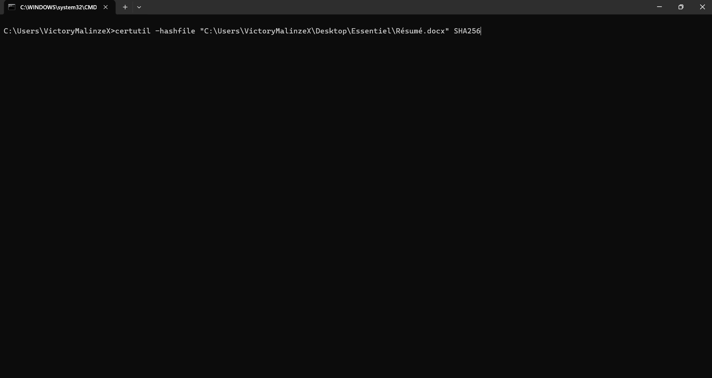

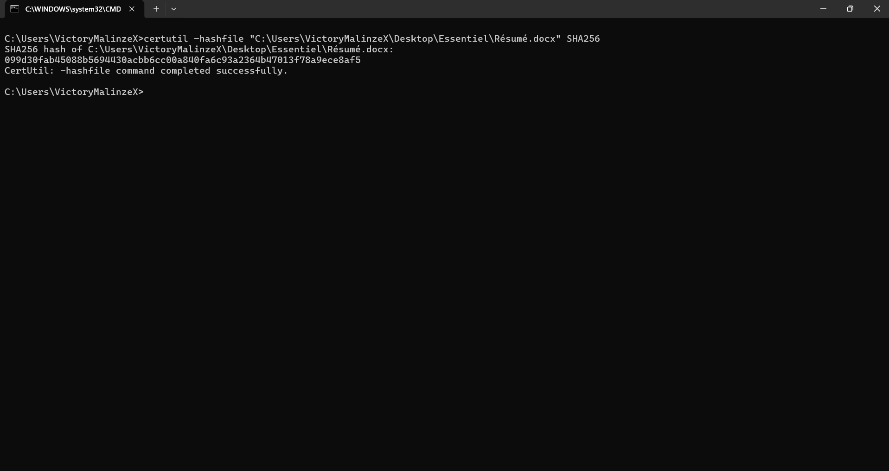

## 5. Common Types of Cyberattacks I Learned About

While studying cybersecurity, I also explored some common types of attacks.

Here are a few that stood out to me:

- **Phishing:** An attacker uses fake emails, messages, or websites to trick people into revealing sensitive information.
- **Password Attacks:** Attackers try to obtain passwords through methods such as brute-force attacks and credential stuffing.
- **Ransomware:** Malicious software that encrypts or locks a victim's data and demands payment.
- **Business Email Compromise (BEC):** An attacker impersonates a trusted person, such as a company executive, to trick someone into sending money or revealing sensitive information.
- **Insider Threats:** Security risks caused by people who already have authorized access to an organization's systems or information.
- **Denial-of-Service (DoS):** An attack intended to make a system or service unavailable to legitimate users.
- **Lost or Stolen Devices:** A lost or stolen computer or phone can expose sensitive information if it is not properly secured.

## 6. What I Learned About Handling Phishing Emails

I learned that phishing emails can be designed to look very convincing. They may appear to come from banks, companies, colleagues, or other trusted sources.

Some things I should look out for include:

- Checking the sender's email address carefully.
- Being cautious of messages that create panic or demand urgent action.
- Avoiding suspicious links and unexpected attachments.
- Confirming unusual requests through official communication channels.
- Reporting suspicious messages through the appropriate channels.
- Asking for help when I am unsure whether a message is legitimate.

One important lesson is that I should not allow urgency or fear to make me act without checking first.

## 7. Cybersecurity Ethics and Responsible Testing

Another important thing I learned is that cybersecurity skills must be used responsibly.

Learning how to scan, investigate, or test systems does not mean I have permission to access any system I choose.

Security testing should only be performed on systems, networks, and applications where explicit authorization has been granted.

My key takeaway is:

**"No written permission means No Testing."**

I want to make sure that whatever I learn and practise is done ethically and responsibly.

## 8. Exploring the NIST Cybersecurity Framework (CSF) 2.0

I also learned about the NIST Cybersecurity Framework, which provides guidance for organizations to manage and reduce cybersecurity risks.

One thing I found interesting is that NIST CSF 2.0 has six core functions:

- **Govern:** Establish cybersecurity policies, responsibilities, strategy, and oversight.
- **Identify:** Understand the organization's assets, systems, and cybersecurity risks.
- **Protect:** Put safeguards in place to reduce cybersecurity risks.
- **Detect:** Identify possible cybersecurity incidents and suspicious activities.
- **Respond:** Take action to contain and manage cybersecurity incidents.
- **Recover:** Restore affected systems and services after an incident.

I learned that these six functions work together to provide a structured approach to cybersecurity risk management.

## 9. My Key Takeaways

Looking back at what I studied and practised, here are some of the things I learned:

- The CIA Triad provides three important principles for protecting information.
- Different security controls help maintain confidentiality, integrity, and availability.
- VirusTotal can help analyze URLs, files, domains, and IP addresses.
- WHOIS can provide publicly available domain registration information.
- `nslookup` helps retrieve DNS information.
- `ipconfig` displays network configuration information.
- `netstat` helps inspect network connections and listening ports.
- Password strength analysis helps me understand the importance of strong and unique passwords.
- Windows EFS can encrypt files and folders.
- SHA-256 hashing can help verify file integrity.
- Phishing and other cyberattacks can affect individuals and organizations.
- Cybersecurity testing must always be performed with proper authorization.
- NIST CSF 2.0 provides six functions for managing cybersecurity risks.

## 10. Tools and Technologies I Used

Here are the tools and Windows features I explored during these exercises:

- VirusTotal
- Who.is
- Password Monster
- Windows Command Prompt
- Windows Encrypting File System (EFS)
- `nslookup`
- `ipconfig`
- `netstat`
- SHA-256

## Conclusion

This learning experience helped me connect some of the cybersecurity concepts I studied with practical activities.

I was able to explore security tools, investigate a domain and an IP address, examine network information, test sample passwords, encrypt a file, and generate a SHA-256 hash.
